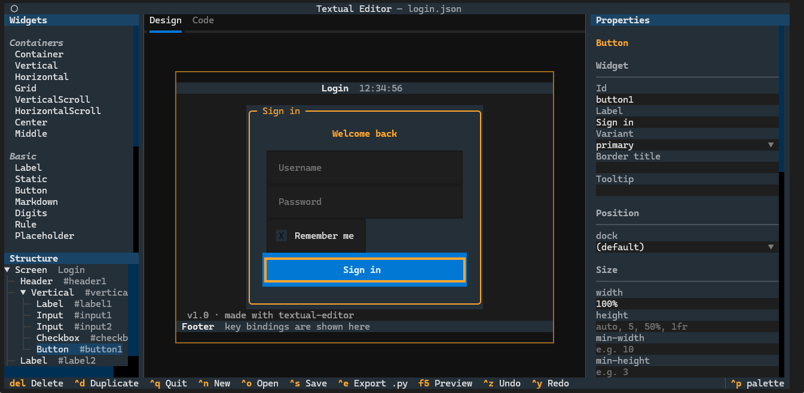
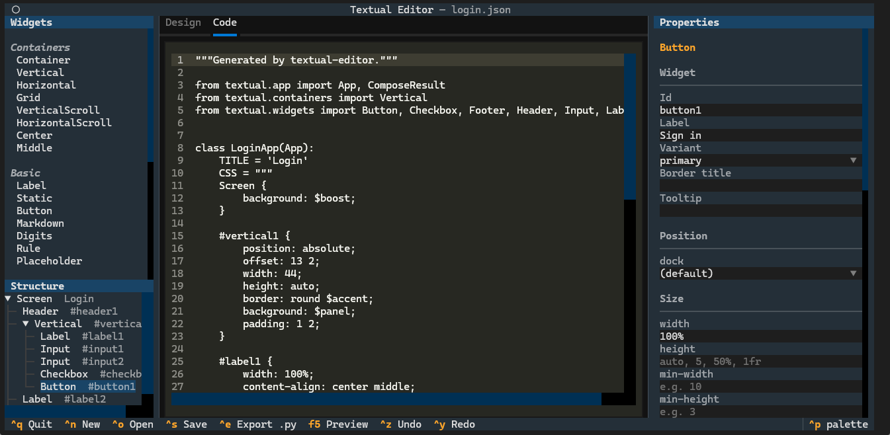
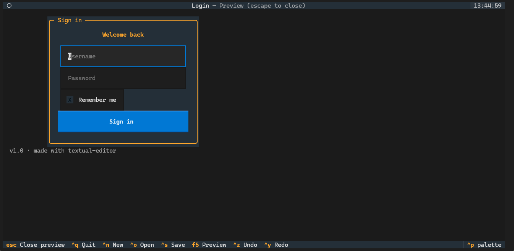

# textual-editor

A visual, drag-and-drop interface builder for [Textual](https://github.com/Textualize/textual),
in the spirit of Swing's GUI builder (NetBeans Matisse): pick widgets from a palette, drag them
on to the screen, move and resize them with the mouse, edit their properties, and export a
runnable Textual app.



## Features

- **Widget palette**: containers (`Container`, `Vertical`, `Horizontal`, `Grid`, scroll views,
  `Center`, `Middle`), basic widgets (`Label`, `Static`, `Button`, `Markdown`, `Digits`, `Rule`,
  `Placeholder`), inputs (`Input`, `TextArea`, `Checkbox`, `RadioButton`, `Switch`, `Select`),
  display widgets (`ProgressBar`, `Sparkline`, `LoadingIndicator`, `Header`, `Footer`), and media
  (`Image`, `Video`).
- **Drag and drop**:
  - drag from the palette on to the canvas (or double-click / press enter to add to the selected container);
  - drag widgets to move them;
  - drag the bottom-right corner to resize;
  - drop a widget on a container to put it inside, or drag it out again.
- **Free layout** (like Swing's absolute/"free design" layout): on the screen, widgets go exactly
  where you drop them (`position: absolute` + `offset`). Containers arrange their children with
  their own layout (vertical, horizontal, grid), and dropping between children inserts at that point.
- **Properties panel**: widget properties (label, text, variant, placeholder, options, …), id,
  border title and tooltip, plus styles: offset, dock, size, margin, padding, layout, grid,
  alignment, colors (including theme variables like `$primary`), `background-image`, border,
  outline, text alignment and style, opacity and visibility. Every value is validated as Textual
  CSS before it is applied.
- **Live code**: the *Code* tab shows the generated Python app as you design.
- **Preview** (<kbd>F5</kbd>): runs the design as a real, interactive screen.
- **Export** (<kbd>Ctrl+E</kbd>): writes a standalone `.py` app.
- **Save / open** designs as JSON (<kbd>Ctrl+S</kbd> / <kbd>Ctrl+O</kbd>), **undo / redo**
  (<kbd>Ctrl+Z</kbd> / <kbd>Ctrl+Y</kbd>), duplicate (<kbd>Ctrl+D</kbd>), delete
  (<kbd>Delete</kbd>), move with the arrow keys and resize with <kbd>Shift</kbd>+arrows.

| Generated code | Preview |
|---|---|
|  |  |

## Installing

textual-editor uses [a fork of Textual](https://github.com/batatinhafcbatatinha-pixel/textual)
which adds native `Image` / `Video` widgets and `background-image` (Sixel graphics, without flicker).

```bash
pip install "textual-editor @ git+https://github.com/batatinhafcbatatinha-pixel/textual-editor.git"
textual-editor                      # start with an empty design
textual-editor examples/login.json  # open a design
```

Or from a clone:

```bash
git clone https://github.com/batatinhafcbatatinha-pixel/textual-editor.git
cd textual-editor
python -m venv .venv
.venv/Scripts/pip install -e ".[dev]"     # Windows (use .venv/bin/pip on Linux / macOS)
python -m textual_editor examples/login.json
```

A wide terminal (around 150 columns) is recommended, so the palette, canvas and properties fit
side by side. The canvas scrolls if the design is bigger than the space available.

## Using the editor

| Action | How |
|---|---|
| Add a widget | Drag it from the palette, or double-click it / press <kbd>Enter</kbd> on it |
| Select | Click on the canvas, or in the *Structure* tree; <kbd>Esc</kbd> selects the parent |
| Move | Drag (free layout), or arrow keys; in a container, arrows reorder |
| Resize | Drag the bottom-right corner, or <kbd>Shift</kbd>+arrows |
| Put inside a container | Drop it on the container |
| Edit properties | Type in the *Properties* panel (applied as you type; invalid values are shown in red) |
| Design size, title, class name | Select the *Screen* (click an empty part of the canvas) |
| Preview | <kbd>F5</kbd> (<kbd>Esc</kbd> to return) |
| Save / Open / Export | <kbd>Ctrl+S</kbd> / <kbd>Ctrl+O</kbd> / <kbd>Ctrl+E</kbd> |
| Undo / Redo | <kbd>Ctrl+Z</kbd> / <kbd>Ctrl+Y</kbd> |

Widgets on the canvas are real Textual widgets, but they are inert while designing: clicks go to
the editor (a button isn't pressed, an input doesn't take focus). The editor's screen redirects
mouse events over the design to the canvas.

## The generated code

Each widget gets an id, its properties become constructor arguments, and its styles become a CSS
rule. For the login example:

```python
class LoginApp(App):
    TITLE = 'Login'
    CSS = """
    #vertical1 {
        position: absolute;
        offset: 13 2;
        width: 44;
        border: round $accent;
        ...
    }
    """

    def compose(self) -> ComposeResult:
        yield Header(id='header1', show_clock=True)
        vertical1 = Vertical(id='vertical1')
        vertical1.border_title = 'Sign in'
        with vertical1:
            yield Label('Welcome back', id='label1')
            yield Input(id='input1', placeholder='Username')
            ...
```

## Design files

Designs are saved as JSON: a tree of nodes, each with a widget `type`, an `id`, `props`
(constructor arguments and attributes) and `styles` (CSS declarations). See
[`examples/login.json`](examples/login.json).

## Project layout

| Module | Responsibility |
|---|---|
| `model.py` | The design document (node tree, ids, moves, JSON) |
| `catalog.py` | The widgets in the palette: constructor arguments and editable properties |
| `styles.py` | The editable CSS properties, and validation |
| `codegen.py` | Design → runnable Python app |
| `builder.py` | Design → live widgets (for the canvas and the preview) |
| `canvas.py` | The canvas: hit testing, selection, move, resize, drop |
| `panels.py` | Palette, structure tree, properties panel |
| `screens.py` | File dialog and preview |
| `app.py` | The editor app: state, undo / redo, files |

## Tests

```bash
pytest
```

The tests cover the model and code generation (the generated app is executed and checked), and
drive the editor with simulated mouse drags: dropping from the palette, moving, resizing,
re-parenting, editing properties, undo / redo, keyboard actions, saving, loading and preview.
